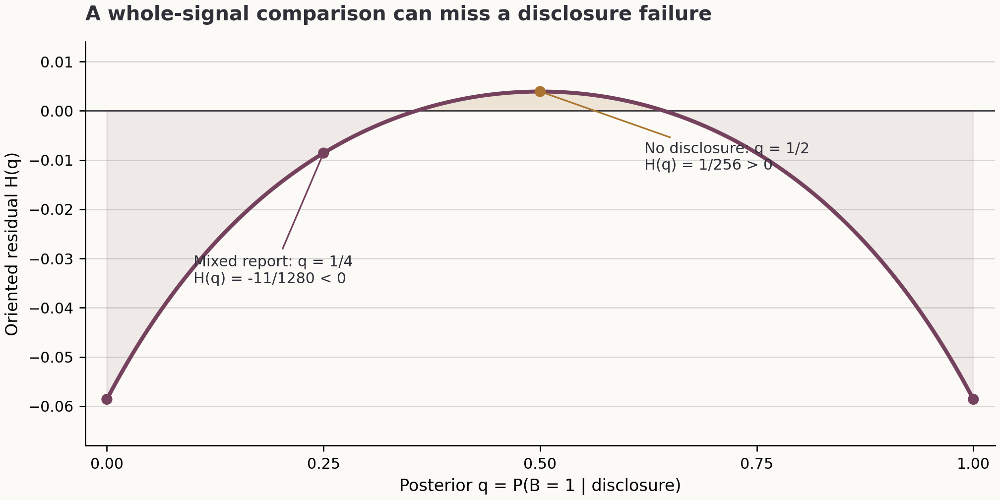

# Four tests for binary informational substitutes

## A complete classification under quadratic scoring

Evidence Press research candidate · Anonymous · Version 1.1.0 · 8 October 2026

### Abstract

We classify strong informational substitutes for a binary event and two binary signals under quadratic scoring. The joint distribution is arbitrary, including distributions with zero-probability cells. For each signal, form its marginal forecast contrast and the conditional forecast contrasts after observing the other signal. Strong substitutability is equivalent to four scalar inequalities: in each direction, the squared marginal contrast must dominate both conditional-row weighted sums of squared conditional contrasts. The proof represents the gap for an arbitrary randomised disclosure as the expectation of an explicit rational expression. An identity decomposes that expression into its endpoint margins and nonnegative square terms. For rational input, any failed test yields a rational two-report disclosure whose expected scores certify the failure directly. The underlying one-direction theorem also covers a binary source, an arbitrary finite second signal and any square-integrable real target under squared loss. We give equality conditions, quantitative margins, structural corollaries and an exact example that is weakly and moderately substitutable but fails strong substitutability. A separate appendix classifies strong complements in the same binary model. The package contains complete proofs, dependency-free exact checkers, finite replay results and a bounded prior-art audit.

## 1. The problem and the precise scope

Let $E,A,B$ take values in $\{0,1\}$. The event $E$ is the target of a forecast; $A$ and $B$ are reports available to the forecaster. The model specifies their complete joint probability distribution. No conditional independence, symmetry, full-support or balanced-prior assumption is imposed.

Use the proper quadratic score $S(p,e)=2pe-p^2$. A forecaster who knows a signal $X$ reports $p=\Pr(E=1\mid X)$ and has value

$$
V(X)=\mathbb{E}\!\left[\Pr(E=1\mid X)^2\right].
$$

Using negative binary Brier loss gives $V(X)-\Pr(E=1)$, changing the value by the same constant for every information set. The categorical quadratic expected score $p^2+(1-p)^2$ multiplies every information-value gap below by two. Thus all classifications are independent of these common normalisations.

We use the March 2017 definition of strong substitutes in Chen and Waggoner, Definition 2.2.3. For two base signals it requires, in both directions,

$$
\Gamma_A(T):=V(B,T)-V(T)-V(A,B)+V(A)\geq 0
$$

for every disclosure $T$ generated from $A$ and independent randomisation. Equivalently, $T$ is conditionally independent of $(E,B)$ given $A$. The other direction exchanges $A$ and $B$. The definition fixes the comparison signals in the subsets lattice and allows the intermediate disclosure to range over the continuous lattice. The source's footnote 4 distinguishes this from full submodularity on arbitrary pairs of elements of the continuous lattice [1].

This is a binary, fixed-score special case of the broader characterisation programme recorded by Chen [2]. We classify this stated target exactly, without claiming resolution of the entire programme. General scoring rules, arbitrary numbers of sources, and full continuous-lattice submodularity are outside the claim. The finite-second-signal extension in Section 3 is one-directional. With only two base sources, the only nontrivial comparisons add one source while partially disclosing the other; adding an already known source gives zero gain, while the remaining containment cases follow from nonnegative value of information. Thus the two singleton orientations exhaust the required tests.

The single whole-signal test is

$$
W:=V(A)+V(B)-V(A,B)-V(\varnothing)\geq 0.
$$

It is obtained by revealing no information from the first source. It tests one possible disclosure. For binary sources, weak and moderate substitutes coincide: a deterministic coarsening of a binary source either reveals it or is constant, up to relabelling and null outcomes. The same observation applies to complements. Section 6 shows that randomised disclosures impose additional restrictions.

## 2. The four-test classification

If either source is almost surely constant, every relevant comparison is an equality. The pair is then both strongly substitutable and strongly complementary. In the remaining case, both outcomes of each source have positive probability.

For the direction that discloses $A$, define

$$
r_{ib}=\Pr(B=b\mid A=i),\qquad \mu_i=\Pr(E=1\mid A=i).
$$

Only compare conditional forecasts in columns that occur under both outcomes of $A$. Write

$$
O_A=\{b:r_{0b}r_{1b}>0\},\qquad D_A=\mu_1-\mu_0,
$$

and, for $b\in O_A$,

$$
d_b=\Pr(E=1\mid A=1,B=b)-\Pr(E=1\mid A=0,B=b).
$$

Define the two margins, indexed by the row supplying the weights,

$$
M_{A,i}=D_A^2-\sum_{b\in O_A}r_{ib}d_b^2,\qquad i=0,1.
$$

Compute $M_{B,0}$ and $M_{B,1}$ by exchanging the two sources.

The residual used in the proof has reversed endpoint indices: $H(0)=M_{A,1}$ and $H(1)=M_{A,0}$.

**Theorem 1 (complete binary classification).** For every joint distribution on $\{0,1\}^3$, with the constant-source convention above, the following are equivalent:

1. The two sources are strong informational substitutes under quadratic scoring.

2. All four margins are nonnegative:

$$
M_{A,0}\geq0,\quad M_{A,1}\geq0,\quad M_{B,0}\geq0,\quad M_{B,1}\geq0.
$$

The statement includes every zero-cell pattern. A conditional forecast at a null cell is never assigned or evaluated. If a column belongs to only one conditional support, seeing that column already identifies the first source, so it contributes no remaining uncertainty about that source.

Each test has a direct interpretation. The squared change between the two forecasts based on the first source alone must be at least as large as the average squared change between those forecasts after the second source is known. Both conditional distributions of the second source supply a required set of weights. This is a statement about the joint forecast model; signal correlation alone does not determine its truth.

## 3. Proof through disclosure loss

We prove a more general oriented result. Let $A$ be binary with $a=\Pr(A=1)\in(0,1)$, let $B$ have any finite alphabet, and let $Y$ be a square-integrable real target. Set $V(X)=\mathbb{E}[\mathbb{E}(Y\mid X)^2]$. Define $r_{ib}$, $\mu_i$, $D$, $d_b$ and $O$ as in Section 2, replacing event probabilities by conditional means of $Y$.

**Theorem 2 (binary source against a finite second signal).** The inequality $\Gamma_A(T)\geq0$ holds for every admissible randomised disclosure of $A$ if and only if

$$
D^2\geq\sum_{b\in O}r_{0b}d_b^2,\qquad D^2\geq\sum_{b\in O}r_{1b}d_b^2.
$$

The disclosure may have any measurable output alphabet. The conclusion concerns the orientation that garbles the binary source. When $B$ is not binary, this theorem alone does not classify the reverse orientation.

### 3.1 The conditional-variance identity

Let $T$ be a disclosure and let $Q=\Pr(A=1\mid T)$. Conditional independence implies that, given $T$, the joint law of $(Y,B)$ is the mixture of its two laws given $A$, with mixture weight $Q$. In particular, $\mathbb{E}(Q)=a$.

Rewrite the substitute gap as the difference between two losses caused by hiding $A$:

$$
\Gamma_A(T)=[V(A)-V(T)]-[V(A,B)-V(T,B)].
$$

Although $T$ may use additional randomness, conditional independence gives $\mathbb{E}(Y\mid A,T)=\mu_A$. The tower property therefore yields

$$
V(A)-V(T)=\mathbb{E}[\operatorname{Var}(\mu_A\mid T)]=D^2\mathbb{E}[Q(1-Q)].
$$

Likewise, put $m_{Ab}=\mathbb{E}(Y\mid A,B=b)$. Conditional independence and the tower property give

$$
V(A,B)-V(T,B)=\mathbb{E}[\operatorname{Var}(m_{AB}\mid T,B)].
$$

At a disclosure posterior $q\in(0,1)$, the probability of $B=b$ is

$$
s_b(q)=(1-q)r_{0b}+qr_{1b}.
$$

For $b\in O$, Bayes' rule gives the conditional probability of $A=1$ as $qr_{1b}/s_b(q)$. Multiplying its Bernoulli variance by $s_b(q)d_b^2$ gives

$$
q(1-q)\frac{r_{0b}r_{1b}d_b^2}{s_b(q)}.
$$

If $b$ occurs in only one row, that conditional variance is zero. Summing proves the identity

$$
\Gamma_A(T)=\mathbb{E}[Q(1-Q)H(Q)],
$$

where

$$
H(q)=D^2-\sum_{b\in O}\frac{r_{0b}r_{1b}d_b^2}{s_b(q)}.
$$

Every denominator in this last sum is strictly positive on the closed interval $[0,1]$. Consequently $H$ has a continuous extension to both endpoints. Pure posteriors contribute zero through the factor $Q(1-Q)$.

### 3.2 The exact nonnegative certificate

For positive $r_0,r_1$, direct multiplication proves

$$
\frac{r_0r_1}{(1-q)r_0+qr_1}=(1-q)r_1+qr_0-\frac{q(1-q)(r_1-r_0)^2}{(1-q)r_0+qr_1}.
$$

Apply this identity to every overlap column. Since $H(0)=M_{A,1}$ and $H(1)=M_{A,0}$, it gives

$$
H(q)=(1-q)M_{A,1}+qM_{A,0}+q(1-q)\sum_{b\in O}\frac{d_b^2(r_{1b}-r_{0b})^2}{s_b(q)}.
$$

If both margins are nonnegative, every term on the right is nonnegative. Substitution into the disclosure-loss identity proves $\Gamma_A(T)\geq0$ for every admissible $T$. No discretisation of disclosure probabilities or bound on the number of reports enters this argument.

Equivalently, $H$ is concave: each subtracted reciprocal-affine term is convex. Its minimum on the interval is attained at an endpoint. The displayed identity supplies an explicit certificate of the same fact and also describes the equality cases.

### 3.3 Why the endpoint tests are necessary

Suppose $H(0)<0$. Continuity gives $q\in(0,a)$ with $H(q)<0$. Consider a two-report disclosure, with one report called mixed, satisfying

$$
\Pr(T=\mathrm{mixed}\mid A=0)=1,\qquad \Pr(T=\mathrm{mixed}\mid A=1)=\frac{(1-a)q}{a(1-q)}.
$$

The second probability lies strictly between zero and one. The mixed report has posterior $q$ and probability $(1-a)/(1-q)$; the other report identifies $A=1$. Its expected substitute gap is therefore

$$
\Gamma_A(T)=(1-a)qH(q)<0.
$$

If $H(1)<0$, choose $q\in(a,1)$ with $H(q)<0$ and use

$$
\Pr(T=\mathrm{mixed}\mid A=1)=1,\qquad \Pr(T=\mathrm{mixed}\mid A=0)=\frac{a(1-q)}{(1-a)q}.
$$

Now the other report identifies $A=0$, and the gap equals $a(1-q)H(q)<0$. Thus either negative endpoint violates the universal disclosure requirement. This proves Theorem 2. Apply it twice to obtain Theorem 1.

**Corollary 2.1 (finite-event extension).** For an event taking finitely many values, let the target be the vector of its event indicators. Its conditional mean is the posterior probability vector. Under the categorical quadratic score, Theorem 2 holds with every scalar square replaced by a squared Euclidean norm. The proof sums the scalar conditional-variance identities coordinatewise; the nonnegative certificate and necessity construction are unchanged. The same calculation works for a square-integrable target in a real Hilbert space. This remains an oriented result when the second source is nonbinary.

## 4. Exact decisions and explicit counterexamples

For a rational input table, all four margins are rational. Testing their signs decides the requested property without optimisation over disclosures. For two binary signals the number of rational arithmetic operations is bounded independently of the input denominator. Bit complexity is polynomial in the input length; this does not mean that arithmetic on arbitrarily large integers has unit cost.

A failed inequality also produces an explicit rational witness. One convenient construction uses

$$
L=\sum_{b\in O}\frac{r_{0b}r_{1b}d_b^2|r_{1b}-r_{0b}|}{\min(r_{0b},r_{1b})^2}.
$$

Differentiating $H$ shows that $|H'(q)|\leq L$. If $H(0)=-\varepsilon<0$, choose

$$
q=\min\{a/2,\varepsilon/(2L)\}\quad(L>0),\qquad q=a/2\quad(L=0).
$$

Then $0<q<a$ and $H(q)\leq-\varepsilon/2<0$. If $H(1)=-\varepsilon<0$, choose

$$
q=1-\min\{(1-a)/2,\varepsilon/(2L)\}\quad(L>0),\qquad q=(1+a)/2\quad(L=0).
$$

The kernels in Section 3.3 then certify failure. Every number is rational, and no limiting disclosure is needed.

The supplied executable uses a tighter one-sided bound. Near zero it retains only columns with $r_{1b}>r_{0b}$ and sets

$$
L_0=\sum_{r_{1b}>r_{0b}}\frac{r_{1b}d_b^2(r_{1b}-r_{0b})}{r_{0b}}.
$$

All sums here remain restricted to the overlap. Directly subtracting $H(0)$ gives $H(q)\leq H(0)+qL_0$. Near one the corresponding bound is

$$
L_1=\sum_{r_{0b}>r_{1b}}\frac{r_{0b}d_b^2(r_{0b}-r_{1b})}{r_{1b}}.
$$

Substitute these bounds for $L$ on the respective side. The implementation then verifies the proposed witness by a separate calculation: it pushes the original eight joint masses through the stochastic kernel, groups the resulting observations, and computes the four expected scores. This check does not reuse the endpoint formula.

The generic fact that an optimal disclosure can use no more reports than the source alphabet is established in Kong and Schoenebeck [3]. Optimisation over Bayes-plausible posterior distributions is also established machinery [4]. The specific endpoint tests and their explicit certificate are the contribution examined here.

## 5. Equality, margins and support

### 5.1 Equality for a given disclosure

Assume both oriented margins are nonnegative. The certificate shows that either $H$ vanishes identically or $H(q)>0$ for every $q\in(0,1)$. More precisely,

$$
H\equiv0\quad\Longleftrightarrow\quad M_{A,0}=M_{A,1}=0\ \mathrm{and}\ d_b(r_{1b}-r_{0b})=0\ \mathrm{for\ every}\ b\in O.
$$

If $H\equiv0$, every disclosure gives equality. Otherwise a disclosure gives equality exactly when $Q\in\{0,1\}$ almost surely, meaning that the disclosure still identifies $A$. Every disclosure that retains positive uncertainty about $A$ gives a strictly positive gap. This operational statement avoids treating the removal of irrelevant random bits as substantive information loss.

### 5.2 A quantitative guarantee

Let $\eta=\min\{M_{A,0},M_{A,1}\}\geq0$. Then

$$
\Gamma_A(T)\geq\eta\mathbb{E}[Q(1-Q)]=\eta\mathbb{E}[\operatorname{Var}(A\mid T)].
$$

The margin therefore controls the substitute gap in proportion to how much uncertainty the disclosure leaves about the source. If $D\ne0$, it also gives

$$
\Gamma_A(T)\geq\frac{\eta}{D^2}[V(A)-V(T)].
$$

Even when both margins vanish, the square terms in the certificate can force strict inequality for every disclosure retaining source uncertainty. For example, replacing each $s_b(q)$ in those terms by $\max\{r_{0b},r_{1b}\}$ gives an explicit lower bound proportional to $\mathbb{E}[Q^2(1-Q)^2]$.

### 5.3 All support cases

If the first source is constant, its disclosures contain only independent randomness; the oriented comparison is an equality. If the second source is constant, adding it gives zero gain. If the two nonconstant sources determine each other, both overlap sets are empty and the tests hold automatically.

For a three-cell signal support, one overlap column remains in each direction. Its contribution is evaluated with the actual conditional weights. For a deterministic event, all forecast contrasts vanish. These cases require no continuity convention for undefined conditional forecasts.

On full-support tables, the four margins are continuous functions of the eight joint masses. Strictly positive margins therefore persist in a sufficiently small neighbourhood. Near a support boundary, small changes can alter conditional forecasts sharply. A pseudocount is a change to the model, not a substitute for the overlap rule.

For a fixed pair of conditional laws given $A=0,1$, the oriented tests do not depend on $a\in(0,1)$. Reweighting those rows changes the witness probabilities but does not change whether that orientation passes. The reverse orientation can change under the same reweighting.

## 6. Exact examples and structural consequences

### 6.1 A nontrivial positive example

Take the following signal masses and event forecasts.

| $(A,B)$ | $\Pr(A,B)$ | $\Pr(E=1\mid A,B)$ |
|---|---:|---:|
| $(0,0)$ | $3/8$ | $1/8$ |
| $(0,1)$ | $1/8$ | $3/8$ |
| $(1,0)$ | $1/8$ | $5/8$ |
| $(1,1)$ | $3/8$ | $7/8$ |

All eight event-signal masses are positive. The two $A$ margins are $9/64$ and the two $B$ margins are $3/16$. Theorem 1 therefore certifies strong substitutes, and Section 5 provides positive quantitative guarantees.

### 6.2 Whole-signal substitutes can fail under partial disclosure

Keep the same signal masses and change the four event forecasts, in row-major order, to

$$
(m_{00},m_{01},m_{10},m_{11})=(9/16,1/16,11/16,3/16).
$$

The event-zero masses are $(21,15,5,39)/128$, and the event-one masses are $(27,1,11,9)/128$. Every mass is positive and their numerators sum to 128. Direct score evaluation gives

$$
V(\varnothing)=9/64,\qquad V(A)=37/256,
$$

$$
V(B)=193/1024,\qquad V(A,B)=49/256.
$$

The whole-signal substitute margin is consequently

$$
W=1/1024>0.
$$

The $A$ margins are both zero. The two $B$ margins are $-15/256$, so the pair fails the strong condition.

Here is a short witness. Disclose the mixed report whenever $B=0$, and with probability $1/3$ when $B=1$. Otherwise report that $B=1$. The mixed report has probability $2/3$ and posterior $\Pr(B=1\mid T=\mathrm{mixed})=1/4$. Direct computation gives

$$
V(A,T)=213/1280,\qquad V(T)=337/2048,
$$

and hence

$$
\Gamma_B(T)=213/1280-337/2048-49/256+193/1024=-11/10240<0.
$$

The example is therefore weakly and moderately substitutable but not strongly substitutable. It is also not strongly complementary, because nonrevealing disclosures in the $A$ direction have a positive gap. The two strong classes do not exhaust the model.

Operationally, a first forecaster receives the partial report $T$ of $B$, then can acquire $A$. The negative gap means that the expected quadratic-score gain from acquiring $A$ after $T$ is smaller than the gain after knowing the full $B$, by exactly $11/10240$. This reverses the required diminishing-value inequality. It is not a claim about a market equilibrium, an optimal purchasing policy, or a distribution inferred from observed forecasts. Figure 1 shows why testing only the undisclosed prior misses the failure.

### 6.3 Conditional independence given the event is insufficient

Let $\Pr(E=1)=1/5$. Conditional on $E$, let the two sources independently report the wrong event value with probability $1/3$. In lexicographic $(E,A,B)$ order, the joint masses are

$$
(16,8,8,4,1,2,2,4)/45.
$$

Their whole-signal substitute margin is $2/11475>0$. Each direction nevertheless has row-weighted margins $241/68850$ and $-989/585225$. Thus strong substitutability fails. This is an exact example within the score-specific distinction already established in the foundational literature [1]; it is not offered as a new general conditional-independence result.

### 6.4 Independent sources

Suppose the two nonconstant sources are independent. Their conditional row weights coincide. The marginal contrast $D_A$ is then the weighted mean of the two conditional contrasts. Jensen's inequality gives

$$
D_A^2\leq\sum_b r_b d_b^2,
$$

with equality exactly when the two contrasts coincide. It follows that strong substitutes hold precisely when

$$
m_{00}+m_{11}=m_{01}+m_{10}.
$$

This is absence of an interaction term in the posterior mean. In that case every disclosure comparison is an equality, so the sources are also strong complements. Independent fair bits with XOR as the target fail this condition; each strong-substitutes margin is $-1$ and the whole-signal margin is $-1/4$.

For completeness, write an arbitrary posterior table under independent sources as a constant plus a multiple of $A$, a multiple of $B$, and $tAB$. Its whole-signal margin is $-t^2\operatorname{Var}(A)\operatorname{Var}(B)$. Thus weak substitutes already force $t=0$ in this independent binary case.

### 6.5 An additive-posterior characterisation

Assume full signal support and an additive posterior mean

$$
\mathbb{E}(E\mid A,B)=\kappa+uA+vB.
$$

**Corollary 3.** The pair is strongly substitutable if and only if

$$
uv\operatorname{Cov}(A,B)\geq0.
$$

To prove it, define $\delta_B=\Pr(B=1\mid A=1)-\Pr(B=1\mid A=0)$ and define $\delta_A$ with the sources exchanged. The four tests reduce to two:

$$
(u+v\delta_B)^2\geq u^2,\qquad(v+u\delta_A)^2\geq v^2.
$$

If $uv\operatorname{Cov}(A,B)\geq0$, the cross terms in both expansions are nonnegative, proving the claim in this direction. Otherwise both ratios $v\delta_B/u$ and $u\delta_A/v$ are negative. The two inequalities would force each ratio to be at most $-2$. Their product would then be at least 4, although

$$
\delta_A\delta_B=\operatorname{Corr}(A,B)^2<1.
$$

Full support supplies the strict final inequality. This contradiction proves necessity. The weak-but-not-strong example has $u=1/8$, $v=-1/2$ and positive source covariance, so it illustrates the failing sign case.

### 6.6 A sufficient source

If $E$ is conditionally independent of $A$ given $B$, the pair is strongly substitutable. In the direction disclosing $A$, every overlap contrast vanishes. In the direction disclosing $B$, the gain from adding $A$ after full $B$ is zero, while its gain after any partial disclosure is nonnegative. The same statement holds with the sources exchanged.

## 7. Relation to earlier work and evidential status

### 7.1 Exact classification versus existing reductions

Chen and Waggoner supply the definition and general score geometry [1]. Kong and Schoenebeck supply a general finite-message reduction [3]. Anunrojwong, Chen, Waggoner and Xu formulate posterior-based optimisation and give approximation algorithms covering quadratic scoring, alongside exact results for piecewise-linear expected scores [4]. The proof here uses conditional variance and binary posterior splitting to obtain a finite exact test for this quadratic case.

The finite-message reduction [3] still leaves an optimisation over report probabilities. The approximation scheme covering quadratic scoring [4] does not by itself decide exact equality on the classification boundary; its exact piecewise-linear results concern a different score class. The binary classification of Börgers, Hernando-Veciana and Krähmer [5] quantifies over decision problems for whole signals. Here the score is fixed and the quantifier ranges over disclosures. These distinctions concern the mathematical predicates, not merely terminology.

### 7.2 Projective substitutes: implication and strict separation

Neyman and Roughgarden's projective substitutes condition [6, Definition 2.8] compares errors in predicting other experts' conditional means. Write $\mu_A=\mathbb E(E\mid A)$, $\mu_B=\mathbb E(E\mid B)$ and $\mu_{AB}=\mathbb E(E\mid A,B)$. Its two decisive margins for two sources are

$$
P_A=\mathbb E[(\mu_A-\mathbb E(\mu_A\mid B))^2]-\mathbb E[(\mu_{AB}-\mu_B)^2],
$$

and $P_B$ with the sources exchanged.

**Proposition 4 (comparison for two binary sources).** Strong quadratic substitutes imply projective substitutes. The converse fails, even with full support.

To reduce the projective definition to these two inequalities, enumerate its two conditioning/predicted subsets and its added source. Containment gives zero error; an added source already present changes nothing; making the conditioning set contain the predicted set gives zero new error. The remaining comparisons are $P_A$, $P_B$, weak substitutes and decreases of variance under conditioning. Weak substitutes follow from $P_A\geq0$, since $\mathbb E[\operatorname{Var}(\mu_A\mid B)]\leq\operatorname{Var}(\mu_A)$. Conversely both displayed margins are instances of the definition.

For nonconstant sources put $a=\Pr(A=1)$, $x=\Pr(B=0\mid A=0)$, $y=\Pr(B=0\mid A=1)$ and $s=(1-a)x+ay$. Conditional variance gives

$$
P_A=a(1-a)\sum_{b\in O_A}\frac{r_{0b}r_{1b}(D_A^2-d_b^2)}{\Pr(B=b)}.
$$

Combining the two denominators gives the identity

$$
P_A=\frac{a(1-a)}{s(1-s)}\left[ay(1-y)M_{A,0}+(1-a)x(1-x)M_{A,1}\right].
$$

All weights are nonnegative. The same calculation for $P_B$ proves the implication, including boundary supports by the overlap convention. If a source is constant, both decisive margins vanish and the remaining comparisons follow from containment or variance monotonicity; they need not all be equalities.

For strict separation take signal masses $(3,1,1,3)/8$ and conditional event probabilities $(1,1,3,5)/8$, in row-major order. Direct calculation gives

$$
(M_{A,0},M_{A,1})=(21,-3)/256,\qquad(M_{B,0},M_{B,1})=(21,13)/256,
$$

but $P_A=27/4096$ and $P_B=51/4096$. Thus all projective comparisons hold and strong substitutes fail. An explicit failure disclosure reports mixed with probabilities $1$ and $1/39$ given $A=0$ and $A=1$, respectively. Direct expected-score evaluation gives $\Gamma_A(T)=-323/8458240$. The supplied exact check evaluates all 32 projective subset/source comparisons and separately scores this disclosure.

This proposition and separator were derived in the supplied AI-assisted review and incorporated in version 1.1.0; they were not part of the original submission. No extension to arbitrary source alphabets is asserted. The rectangle condition of Frongillo, Neyman and Waggoner [7, Definition 2.6] also differs: with binary sources every proper nonempty subrectangle fixes a source, making its weak-substitutes comparison an equality. Rectangle substitutes therefore coincide with weak substitutes here, and Section 6.2 separates them from the strong condition.

### 7.3 Evidence and limitations

The prior-art search was frozen on 8 October 2026. It inspected the originating statement, the principal prediction-market papers and relevant alternative notions, then repeated formula and alias searches after discovering the rational residual and weighted-contrast form. No equivalent endpoint criterion was found in that bounded search. This finding supports presenting the explicit theorem; it does not establish historical priority. The search log records the English-language corpus, inspected locations and access limits. No claim to solve the unrestricted characterisation programme is made.

The mathematical proof covers real probability tables and all admissible measurable disclosures. The executable checks use exact rational arithmetic and verify stated finite domains. They support the algebra and implementation but do not replace the universal proof. The supplied AI-assisted review is retained as review evidence; reviewer identity and external independence are not established. No proof-assistant formalisation is claimed.

The inputs are model probabilities. This paper does not estimate them from data or claim that observed forecasts in a real information market satisfy the model. A table estimated from sparse data needs an uncertainty analysis for its four margins, especially near missing cells. The theorem identifies what must be established about that table; it does not supply the empirical evidence.

## Appendix A. A complete strong-complements test

This appendix concerns the same two-binary-source model and reversed disclosure inequalities. It supplies an additional exact classification; it is not needed for Theorem 1.

Fix the direction disclosing $A$. Set

$$
b_i=\Pr(B=1\mid A=i),\quad c_i=\operatorname{Cov}(E,B\mid A=i),\quad v_i=b_i(1-b_i).
$$

Let $h_i=c_i^2/v_i$ when $v_i>0$, and let $h_i=0$ when $v_i=0$. A deterministic $B$ row has $c_i=0$, so $c_i^2=v_i h_i$ remains valid in every case. Put

$$
d=b_1-b_0,\quad w=d(\mu_1-\mu_0),\quad b(q)=(1-q)b_0+qb_1,
$$

$$
c(q)=(1-q)c_0+qc_1+q(1-q)w,\qquad l(q)=(1-q)h_0+qh_1.
$$

The marginal value of observing binary $B$ under the mixture $q$ is $c(q)^2/[b(q)(1-b(q))$. Subtract the full-revelation chord $l(q)$ and clear the positive denominator. Direct expansion gives

$$
c(q)^2-b(q)(1-b(q))l(q)=q(1-q)F(q),
$$

where

$$
F(q)=(1-q)K_0+qK_1+w^2q(1-q),
$$

$$
K_0=2c_0c_1+2c_0w-v_0h_1-(v_1+d^2)h_0,
$$

$$
K_1=2c_0c_1+2c_1w-v_1h_0-(v_0+d^2)h_1.
$$

The plus sign on both $2c_iw$ terms is essential. The polynomial verification script expands the identity exactly using the two row relations.

The connection to the main proof is direct:

$$
F(q)=b(q)(1-b(q))H(q),\qquad K_0=v_0M_{A,1},\qquad K_1=v_1M_{A,0}.
$$

Consequently the same quadratic is

$$
F(q)=(1-q)v_0M_{A,1}+qv_1M_{A,0}+(b_1-b_0)^2D_A^2q(1-q).
$$

For interior posteriors the first identity follows by equating the two disclosure-loss calculations. Continuity extends the polynomial identity to endpoints, including a deterministic row, with the overlap convention. Its endpoint values and quadratic coefficient determine the last display. Thus the complements test uses the same residual, rather than a separate information-value principle.

The coefficients can also be checked without a full expansion. If $N(q)=c(q)^2-b(q)(1-b(q))l(q)$, then $N(0)=N(1)=0$, $K_0=N'(0)$ and $K_1=-N'(1)$. Its coefficient of $q^4$ is $w^2$. These facts determine the displayed factorisation and fix the signs at both endpoints.

If the second source is nonconstant, its mixture variance is positive for every $q\in(0,1)$. As in Section 3.3, a positive residual at any interior posterior yields a two-report violation of the complement inequality by balancing that posterior with a pure one. Thus the orientation is strongly complementary exactly when $F(q)\leq0$ throughout $[0,1]$.

**Proposition 5 (complete binary complements classification).** Set $R=w^2$ and $U=K_1-K_0+R$, so that $F(q)=K_0+Uq-Rq^2$. The exact finite criterion in each orientation is

$$
K_0\leq0,\qquad K_1\leq0,
$$

and, only when $R>0$ and $0<U<2R$,

$$
4RK_0+U^2\leq0.
$$

The additional condition tests the interior vertex $q=U/(2R)$. If the quadratic is linear or its vertex lies outside the interval, the endpoints suffice. Apply this test in both directions. Constant sources are handled as in Section 2. This completes the ancillary complements classification, including boundary supports.

## References

### Definitions and problem statement

[1] Chen, Y., & Waggoner, B. (2017). *Informational substitutes* [Expanded preprint of the FOCS 2016 paper]. arXiv. https://arxiv.org/abs/1703.08636

[2] Chen, Y. (n.d.). *Operational characterizations of informational substitutes and complements* [Contributed problem statement]. EconCS-bench. Retrieved October 8, 2026, from https://github.com/aieconcs/econcs-bench/blob/main/informational-substitutes-complements/PROBLEM.md

### Disclosure and posterior optimisation

[3] Kong, Y., & Schoenebeck, G. (2018). Optimizing Bayesian information revelation strategy in prediction markets: The Alice Bob Alice case. *Leibniz International Proceedings in Informatics, 94*, 14:1-14:20. https://doi.org/10.4230/LIPIcs.ITCS.2018.14

[4] Anunrojwong, J., Chen, Y., Waggoner, B., & Xu, H. (2019). Computing equilibria of prediction markets via persuasion. In *Web and Internet Economics* (pp. 45-56). https://doi.org/10.1007/978-3-030-35389-6_4. Expanded preprint inspected: https://arxiv.org/abs/2009.03607

### Additional comparisons

[5] Börgers, T., Hernando-Veciana, A., & Krähmer, D. (2013). When are signals complements or substitutes? *Journal of Economic Theory, 148*(1), 165–195. https://doi.org/10.1016/j.jet.2012.12.012

[6] Neyman, E., & Roughgarden, T. (2022). Are you smarter than a random expert? The robust aggregation of substitutable signals. *Proceedings of the 23rd ACM Conference on Economics and Computation*, 990–1012. https://doi.org/10.1145/3490486.3538243. Full text: https://arxiv.org/abs/2111.03153

[7] Frongillo, R., Neyman, E., & Waggoner, B. (2021). *Agreement implies accuracy for substitutable signals* [Preprint]. https://arxiv.org/abs/2111.03278

## Sanity checks and verification scope

Repeated sources pass through empty support overlap. Independent additive forecasts give zero gaps for every disclosure. Independent XOR gives four negative margins. In the full-support separation example, the eight integer masses sum to 128, the whole-signal gap is $1/1024$, and the explicit stochastic kernel gives $-11/10240$. The exact replay and symbolic residual logs in the accompanying package report the additional verification domains and counts.
